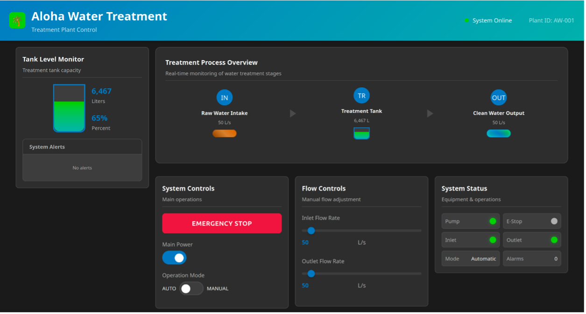

# Aloha Water Treatment

A simulated water treatment plant with Modbus and BACnet process control, built as a target for [MITRE Caldera™ for OT](https://github.com/mitre/caldera-ot). For a walkthrough, read [Caldera for OT Aloha Water Treatment: More Virtual OT Sandboxes!](https://medium.com/@mitrecaldera/caldera-for-ot-aloha-water-treatment-more-virtual-ot-sandboxes-080dc437da89).



## Authors

Originally developed by Samir Boussarhane for a UH Manoa workshop.

In collaboration with MITRE Caldera™ for OT ([ot@mitre.org](mailto:ot@mitre.org)).

Aloha Water Treatment is intended to grow open source collaboration in OT. We encourage forks and pull requests with improvements, new features, deployment notes, documentation, and tests.

## Description

The plant pumps water into a 10,000 liter treatment tank and out to clean water output. A PLC runs the process and exposes it over Modbus TCP or BACnet/IP, and a web HMI shows the tank, the flows, the pump and valves, and the alarms, and lets an operator control them.

* In automatic mode the PLC keeps the tank near two thirds full, raising the inflow the further the level is below that target, and stops draining when the level falls to 1,000.
* In manual mode the operator sets the inflow and outflow rates directly.
* The emergency stop stops the pump, closes both valves and sets both flows to zero.
* The overflow alarm turns on when the tank reaches 10,000, the low level alarm when water still drains out at or below 1,000, and the operator error alarm when a manual flow pushes an already low or high tank further.

## Getting Started

### Dependencies

* Python 3.12+
* BAC0, bacpypes3, Flask, pymodbus, python-dotenv (see `requirements.txt`)

### Installation

```bash
git clone https://github.com/mitre/aloha-water-treatment.git
cd aloha-water-treatment
pip install -r requirements.txt
```

## Usage

### Run Script

```bash
python run.py
```

The script asks for the protocol, then how to run the simulator. For Modbus:

```
Aloha Water Treatment Simulator

Protocol:
1. Modbus
2. BACnet

Deployment:
1. Local (PLC + HMI)
2. PLC only
3. HMI only
```

For BACnet:

```
Deployment:
1. PLC only
2. HMI only
```

* **Local (PLC + HMI)** starts the PLC in the background, waits until it accepts connections, then opens the HMI. Closing the HMI stops the PLC.
* **PLC only** runs the PLC. The host is the address it binds to (default `0.0.0.0` for Modbus, `auto` for BACnet).
* **HMI only** runs the HMI against a PLC elsewhere. The host is the PLC's address (default `127.0.0.1`).

It then asks for the PLC host and the PLC port (default `5020` for Modbus, `47808` for BACnet). The HMI is a web page at http://localhost:8090. Local is not offered for BACnet, because the PLC and the HMI each need UDP 47808; run them on different hosts or containers.

### Modules

```bash
python -m simulator.plc
python -m simulator.hmi
```

PLC (`simulator.plc`):

| Flag | Default | Description |
|---|---|---|
| `--config PATH` | `.env.example` | Configuration file of `ALOHA_*` settings |
| `--host HOST` | `0.0.0.0` (Modbus), `auto` (BACnet) | Address to bind. BACnet: `auto` or `IP/prefix` |
| `--port PORT` | `5020` (Modbus), `47808` (BACnet) | Modbus TCP or BACnet/IP UDP port |
| `--protocol {modbus,bacnet}` | `modbus` | Protocol to serve |
| `--debug` | off | Debug logging |

HMI (`simulator.hmi`):

| Flag | Default | Description |
|---|---|---|
| `--config PATH` | `.env.example` | Configuration file of `ALOHA_*` settings |
| `--host HOST` | `127.0.0.1` | PLC to poll |
| `--port PORT` | `5020` (Modbus), `47808` (BACnet) | PLC port |
| `--protocol {modbus,bacnet}` | `modbus` | Protocol of the PLC |
| `--web-port PORT` | `8090` | Web HMI port |
| `--client-cidr PREFIX` | from the interface, else `24` | Prefix length of the HMI's own BACnet address; match the PLC's subnet |
| `--debug` | off | Debug logging |

The `ALOHA_IP`, `ALOHA_PORT` and `ALOHA_PROTOCOL` settings set the defaults for `--host`, `--port` and `--protocol`. Environment variables take precedence over the `--config` file. To start from a `.env` file, copy `.env.example` to `.env`, adjust it, and run `python runenv.py`. `ALOHA_RUNMODE` picks `local`, `plc` or `hmi`.

### Docker

`docker/docker-compose.yml` runs the Modbus PLC, the web HMI, Caldera with the Modbus and BACnet plugins, and a Sandcat agent on one network:

```bash
docker compose -f docker/docker-compose.yml up --build -d
```

| Service | Address |
|---|---|
| Caldera | http://localhost:8888 (login `admin` / `admin`) |
| Web HMI | http://localhost:8090 |
| Modbus PLC | `localhost:5020` |

All ports are published on `127.0.0.1` only. Caldera starts with the Aloha Water Treatment fact source and adversary profiles loaded.

The image runs the PLC with `python -m simulator.plc` and ignores `ALOHA_RUNMODE`. To run the HMI from it, set the entrypoint to `python -m simulator.hmi`, as the compose file's HMI service does. The `ALOHA_IP`, `ALOHA_PORT` and `ALOHA_PROTOCOL` variables still set the flag defaults.

BACnet/IP uses UDP 47808, and discovery uses broadcasts, which do not cross Docker's port publishing, so 47808 is not published to the host. Caldera's agent and the HMI reach the PLC on the Docker network.

The `bacnet` profile adds the BACnet PLC and its HMI on http://localhost:8091:

```bash
docker compose -f docker/docker-compose.yml --profile bacnet up --build -d
```

An optional Wireshark container shares the PLC's network, so it sees the HMI polling and the Modbus traffic from the Caldera agent:

```bash
docker compose -f docker/docker-compose.yml --profile capture up -d capture
```

Open https://127.0.0.1:3001 and start a capture on `eth0`. Saved captures land in `docker/captures/`.

## Modbus Map

The Modbus PLC listens on TCP port 5020. The PLC rewrites the points it sets every second, so a client's write to one of them does not last.

### Coils (Read/Write)

| Address | Name | Description |
|---|---|---|
| 0 | EmergencyStop | Emergency stop (1 = active) |
| 1 | PumpSwitch | Pump switch (1 = on) |
| 2 | PumpStatus | Pump status (1 = running), set by the PLC |
| 3 | InflowValve | Inflow valve (1 = open), set by the PLC |
| 4 | OutflowValve | Outflow valve (1 = open), set by the PLC |
| 5 | InflowMode | Mode select (0 = auto, 1 = manual) |
| 6 | OverflowAlarm | Overflow alarm (1 = active), set by the PLC |
| 7 | LowLevelAlarm | Low level alarm (1 = active), set by the PLC |
| 8 | OperatorErrorAlarm | Operator error alarm (1 = active), set by the PLC |

### Holding Registers (Read/Write)

| Address | Name | Description |
|---|---|---|
| 0 | TankLevel | Tank level in liters (0-10000) |
| 1 | EmergencyStop | Emergency stop (1 = active), follows coil 0 |
| 2 | PumpSwitch | Pump switch (1 = on), follows coil 1 |
| 3 | PumpStatus | Pump status (1 = running), set by the PLC |
| 4 | InflowValve | Inflow valve (1 = open), set by the PLC |
| 5 | OutflowValve | Outflow valve (1 = open), set by the PLC |
| 6 | InflowRate | Inflow rate in liters per second, set by the PLC in auto mode |
| 7 | OutflowRate | Outflow rate in liters per second, set by the PLC in auto mode |
| 8 | InflowMode | Mode select (0 = auto, 1 = manual), follows coil 5 |
| 9 | OverflowAlarm | Overflow alarm (1 = active), set by the PLC |

## BACnet Map

The BACnet PLC is device 1001 on UDP port 47808.

### Analog Values (Read/Write)

| Instance | Name | Description |
|---|---|---|
| 1 | TankLevel | Treatment tank water level in liters (0-10000) |
| 2 | InflowRate | Inlet flow rate in liters per second, set by the PLC in auto mode |
| 3 | OutflowRate | Outlet flow rate in liters per second, set by the PLC in auto mode |

### Binary Values (Read/Write)

| Instance | Name | Description |
|---|---|---|
| 1 | EmergencyStop | Emergency stop button (active = stopped) |
| 2 | PumpSwitch | Main pump switch (active = on) |
| 3 | ManualMode | Auto/manual mode (inactive = auto, active = manual) |

### Binary Outputs (Read)

| Instance | Name | Description |
|---|---|---|
| 1 | PumpStatus | Pump operational state |
| 2 | InflowValve | Inlet valve state |
| 3 | OutflowValve | Outlet valve state |
| 4 | OverflowAlarm | High level alarm |
| 5 | LowLevelAlarm | Low level alarm |
| 6 | OperatorErrorAlarm | Operator error / safety violation |

The HMI writes at priority 8 (manual operator).

## Adding a Protocol

For notes on adding another protocol, see [Adding a Protocol](docs/adding-protocol.md).

## Caldera OT Integration

This repo ships a fact source and adversary profiles for [MITRE Caldera™ for OT](https://github.com/mitre/caldera-ot) and its [Modbus](https://github.com/mitre/modbus) and [BACnet](https://github.com/mitre/bacnet) plugins. The Docker lab loads them for you. To use them with your own Caldera server, copy them into the plugin directories below, adjust the values for your network, and restart Caldera:

| File | Destination |
|---|---|
| `docs/sources/aloha-simulator-facts.yml` | `plugins/modbus/data/sources/` |
| `docs/adversaries/modbus-*.yml` | `plugins/modbus/data/adversaries/` |
| `docs/adversaries/bacnet-*.yml` | `plugins/bacnet/data/adversaries/` |

### Scenarios

Each scenario has a Modbus and a BACnet adversary. The BACnet ones need the BACnet PLC (the `bacnet` profile in Docker).

| Adversary | Scenario | Description |
|---|---|---|
| Aloha Modbus Reconnaissance, Aloha BACnet Reconnaissance | [Scenario 1](docs/scenarios/scenario_1_reconnaissance.md) | Read process values and control points without changing state |
| Aloha Modbus Manual Overflow, Aloha BACnet Manual Overflow | [Scenario 2](docs/scenarios/scenario_2_manual_overflow.md) | Switch to manual mode and set the inflow far above the outflow until the tank overflows |
| Aloha Modbus Emergency Stop, Aloha BACnet Emergency Stop | [Scenario 3](docs/scenarios/scenario_3_emergency_stop.md) | Trigger the emergency stop and halt the process |

## Running Tests

```bash
pip install pytest==8.3.5 pytest-asyncio==0.25.3 pytest-cov==6.0.0
python -m pytest tests/
```

`bash docker/smoke-test.sh` builds and starts the Docker lab, then has Caldera run one read per protocol against the PLC. CI runs both.

## Other Simulators

MITRE provides other open-source simulators for testing the Caldera for OT plugins without physical hardware.

### [Grid Watch](https://github.com/mitre/grid-watch)

Grid Watch is a simulated electrical grid outstation with DNP3 process control.

### [HVACSim](https://github.com/mitre/hvac-sim)

HVACSim is a simulated server-room HVAC controller with BACnet process control.

### [Wildcat Dam](https://github.com/mitre/wildcatdam)

Wildcat Dam is a simulated dam controller with Modbus process control.

## Acknowledgements

* [Caldera](https://github.com/apache/caldera) - automated adversary emulation platform
* [Caldera for OT](https://github.com/mitre/caldera-ot) - Caldera plugins for OT protocols
* [pymodbus](https://github.com/pymodbus-dev/pymodbus) - Modbus TCP server and client
* [BAC0](https://github.com/ChristianTremblay/BAC0) and [BACpypes3](https://github.com/JoelBender/BACpypes3) - BACnet/IP device and client
* [Flask](https://github.com/pallets/flask) - web HMI
* [python-dotenv](https://github.com/theskumar/python-dotenv) - `.env` loading for `runenv.py` and `--config`
* [jQuery](https://jquery.com/) - web HMI scripting
* [MITRE ATT&CK for ICS](https://attack.mitre.org/matrices/ics/) - techniques used in the scenarios

## License

This project is licensed under the Apache-2.0 License; see the LICENSE file for details.

© 2026 The MITRE Corporation. Approved for Public Release; Distribution Unlimited. Case Number 26-0170.
