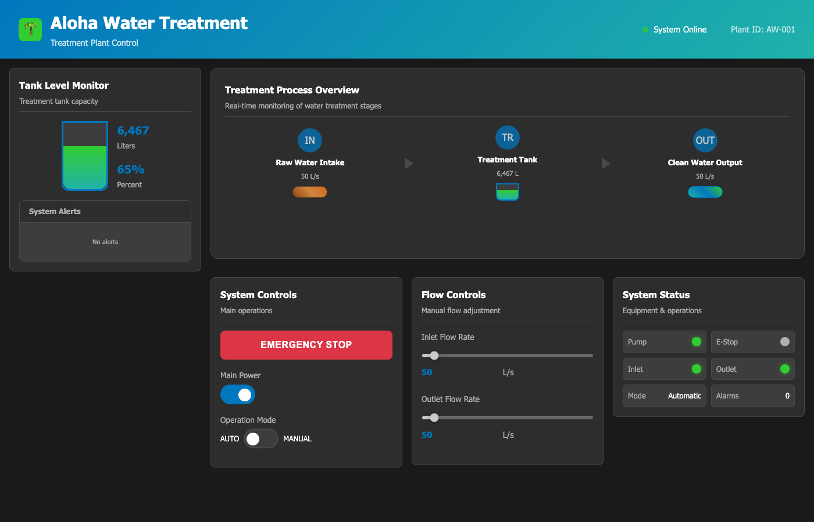

# Scenario 1: Reconnaissance

## Overview

| Field | Value |
|---|---|
| **Tactic** | Discovery, Collection |
| **Techniques** | [T0861 - Point & Tag Identification](https://attack.mitre.org/techniques/T0861/); BACnet variant also [T0846 - Remote System Discovery](https://attack.mitre.org/techniques/T0846/), [T0888 - Remote System Information Discovery](https://attack.mitre.org/techniques/T0888/) |
| **Adversary** | Aloha Modbus Reconnaissance (`docs/adversaries/modbus-reconnaissance.yml`), Aloha BACnet Reconnaissance (`docs/adversaries/bacnet-reconnaissance.yml`) |
| **Fact source** | Aloha Modbus Reconnaissance Facts (`docs/sources/aloha-modbus-reconnaissance.yml`), Aloha BACnet Reconnaissance Facts (`docs/sources/aloha-bacnet-reconnaissance.yml`) |

## Description

The adversary reads the PLC's process values and control points without changing anything. The PLC answers any client without authentication, so the reads give a baseline of the tank level, flow rates, pump and valve state, operating mode and alarms before an attack.

## Modbus Variant

### Facts Used

| Fact | Description | Type | Value |
|---|---|---|---|
| `modbus.server.ip` | IP address of the Modbus PLC | string | `127.0.0.1` |
| `modbus.server.port` | TCP port of the Modbus PLC | int | `5020` |
| `modbus.read_coil.start` | First coil to read | int | `0` |
| `modbus.read_coil.count` | Number of coils to read | int | `9` |
| `modbus.read_holding.start` | First holding register to read | int | `0` |
| `modbus.read_holding.count` | Number of holding registers to read | int | `10` |

### Steps

Run the adversary with the fact source above, or add these abilities to an operation in this order:

| # | Ability | ID | Facts |
|---|---|---|---|
| 1 | Modbus - Read Coils | `d80b9cd5-b1d8-482a-a745-71d74f9d0885` | read: `modbus.read_coil.start=0`, `modbus.read_coil.count=9` |
| 2 | Modbus - Read Holding Registers | `bc8961a2-7534-4b2a-bbc3-2456f58243be` | read: `modbus.read_holding.start=0`, `modbus.read_holding.count=10` |

## BACnet Variant

### Facts Used

| Fact | Description | Type | Value |
|---|---|---|---|
| `bacnet.device.instance` | Device instance of the BACnet PLC | int | `1001` |
| `bacnet.obj.type` | Object type for Read Property | string | `device` |
| `bacnet.obj.instance` | Object instance for Read Property | int | `1001` |
| `bacnet.obj.property` | Property for Read Property | int | `76` (object-list) |
| `bacnet.read.index` | Array index for Read Property | int | `-2` (whole array) |
| `bacnet.object.type` | Object type for Object Collection | string | `analog-value` |
| `bacnet.object.instance` | Object instance for Object Collection | int | `1` (TankLevel) |

### Steps

Run the adversary with the fact source above, or add these abilities to an operation in this order:

| # | Ability | ID | Facts |
|---|---|---|---|
| 1 | BACnet Who-Is | `b93bd80e-3a70-11eb-adc1-0242ac120002` | discover |
| 2 | BACnet Device Collection - Basic | `485e97e7-c352-432d-b8d3-fa8460e4fe49` | device: `bacnet.device.instance=1001` |
| 3 | BACnet Read Property | `47432648-5678-11eb-ae93-0242ac130002` | read: `bacnet.obj.type=device`, `bacnet.obj.instance=1001`, `bacnet.obj.property=76`, `bacnet.read.index=-2` |
| 4 | BACnet Object Collection - Basic | `bd13ac81-b932-463d-95aa-a22aeefbc9ac` | read: `bacnet.object.type=analog-value`, `bacnet.object.instance=1` |

## Expected Observations

- The PLC answers every read without authentication, and no process value changes.
- Modbus: Read Coils returns coils 0-8 and Read Holding Registers returns registers 0-9, as listed in the README's Modbus map. On a freshly started PLC the pump switch is off, so every coil reads `OFF` and every register reads `0`.
- BACnet: Who-Is lists device `1001`. Device Collection and Read Property list the device object and its 12 points: `analog-value` 1-3, `binary-value` 1-3 and `binary-output` 1-6.
- BACnet: In the Docker lab the HMI's own BACnet client answers Who-Is as well, as device `9101`, and Who-Is adds it to the fact pool. Caldera then runs Device Collection, Read Property and Object Collection once for each discovered device instance, so each also runs against `9101`. `9101` carries no tank objects: Device Collection returns the HMI's own device record (object-name `BAC0`), Object Collection returns nothing, and Read Property returns `BACnet Error: object: unknown-object`.
- BACnet: Object Collection returns `analog-value` 1 with object-name `TankLevel` and the current tank level as its present-value.
