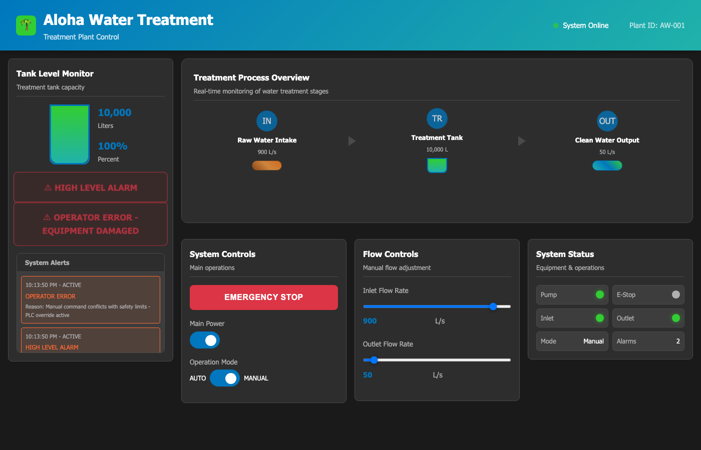

# Scenario 2: Manual Overflow

## Overview

| Field | Value |
|---|---|
| **Tactic** | Impair Process Control, Impact |
| **Techniques** | [T1692.001 - Unauthorized Message: Command Message](https://attack.mitre.org/techniques/T1692/001/), [T0831 - Manipulation of Control](https://attack.mitre.org/techniques/T0831/), [T0826 - Loss of Availability](https://attack.mitre.org/techniques/T0826/) |
| **Adversary** | Aloha Modbus Manual Overflow (`docs/adversaries/modbus-manual-overflow.yml`), Aloha BACnet Manual Overflow (`docs/adversaries/bacnet-manual-overflow.yml`) |
| **Fact source** | Aloha Modbus Manual Overflow Facts (`docs/sources/aloha-modbus-manual-overflow.yml`), Aloha BACnet Manual Overflow Facts (`docs/sources/aloha-bacnet-manual-overflow.yml`) |

## Description

The adversary turns the pump on, switches the plant to manual mode, and sets the inflow far above the outflow. In automatic mode the PLC keeps the tank near two thirds full, but in manual mode it takes the written flow rates as given, so the tank fills until it overflows.

Modbus and BACnet differ in how many writes this takes. Modbus has function codes that write a block of coils and a block of registers at once, so one adversary does the whole attack. BACnet's WriteProperty writes one property per call, so the adversary turns the pump on and the rest of the overflow is a manual exercise below.

## Modbus Variant

### Facts Used

| Fact | Description | Type | Value |
|---|---|---|---|
| `modbus.server.ip` | IP address of the Modbus PLC | string | `127.0.0.1` |
| `modbus.server.port` | TCP port of the Modbus PLC | int | `5020` |
| `modbus.write_coil.start` | First coil of the write block | int | `1` (PumpSwitch) |
| `modbus.write_coil.values` | Coil values to write | string | `1,0,0,0,1` (coils 1-5) |
| `modbus.write_register.start` | First register of the write block | int | `6` (InflowRate) |
| `modbus.write_register.values` | Register values to write | string | `900,50` (registers 6-7) |
| `modbus.read_coil.start` | First coil to read | int | `0` |
| `modbus.read_coil.count` | Number of coils to read | int | `9` |
| `modbus.read_holding.start` | First holding register to read | int | `0` |
| `modbus.read_holding.count` | Number of holding registers to read | int | `10` |

### Control Data

| Control | Modbus Address | Value |
|---|---|---|
| PumpSwitch | Coil `1` | `ON` |
| InflowMode | Coil `5` | `ON` (manual) |
| InflowRate | Holding register `6` | `900` |
| OutflowRate | Holding register `7` | `50` |

Write Multiple Coils writes coils `1-5` in one request. Coils `2-4` (PumpStatus, InflowValve, OutflowValve) are owned by the PLC, which rewrites them each cycle, so only PumpSwitch (`1`) and InflowMode (`5`) stick.

### Steps

Run the adversary with the fact source above, or add these abilities to an operation in this order:

| # | Ability | ID | Facts |
|---|---|---|---|
| 1 | Modbus - Write Multiple Coils | `fe321da2-e183-44a3-b423-b8cba9a8bda0` | pump on, manual: `modbus.write_coil.start=1`, `modbus.write_coil.values=1,0,0,0,1` |
| 2 | Modbus - Write Multiple Registers | `0f16b341-9730-4553-b6d6-8eb8def02c81` | inflow/outflow: `modbus.write_register.start=6`, `modbus.write_register.values=900,50` |
| 3 | Modbus - Read Holding Registers | `bc8961a2-7534-4b2a-bbc3-2456f58243be` | verify: `modbus.read_holding.start=0`, `modbus.read_holding.count=10` |
| 4 | Modbus - Read Coils | `d80b9cd5-b1d8-482a-a745-71d74f9d0885` | verify: `modbus.read_coil.start=0`, `modbus.read_coil.count=9` |

### Expected Observations

- The PLC accepts both writes without authentication and logs each one: `Client wrote coils 1-5 = ON,OFF,OFF,OFF,ON` and `Client wrote holding registers 6-7 = 900,50`.
- The pump switch and manual mode turn on: coils 1 and 5 read `ON` (holding registers 2 and 8 follow), and the HMI shows the pump running in manual mode.
- The inflow rate reads `900` and the outflow rate `50` (holding registers 6 and 7), so the tank level rises by 850 each second.
- Once the level passes 9000 with inflow still on, the operator error alarm (coil 8) turns on. When the level reaches 10000, the overflow alarm (coil 6) turns on for one cycle and the PLC cuts the inflow to `0`.
- After the overflow the level falls by 50 each second. The verify reads show the tank level between 9000 and 10000 and an inflow of `0`, or a rising level if the tank has not filled yet.

## BACnet Variant

### Facts Used

| Fact | Description | Type | Value |
|---|---|---|---|
| `bacnet.device.instance` | Device instance of the BACnet PLC | int | `1001` |
| `bacnet.obj.type` | Object type to write | string | `binary-value` (PumpSwitch) |
| `bacnet.obj.instance` | Object instance to write | int | `2` (PumpSwitch) |
| `bacnet.obj.property` | Property to write | string | `present-value` |
| `bacnet.write.priority` | Write priority | int | `8` (manual operator, the same as the HMI) |
| `bacnet.write.index` | Array index to write | int | `-1` (whole property) |
| `bacnet.write.tag` | Application tag of the value | int | `9` (enumerated, binary values) |
| `bacnet.write.value` | Value to write | int | `1` (active) |
| `bacnet.object.type` | Object type for Object Collection | string | `binary-output` (PumpStatus) |
| `bacnet.object.instance` | Object instance for Object Collection | int | `1` (PumpStatus) |

### Control Data

| Control | BACnet Object | Value |
|---|---|---|
| PumpSwitch | `binary-value 2 present-value` | `active` |

### Steps

Run the adversary with the fact source above, or add these abilities to an operation in this order:

| # | Ability | ID | Facts |
|---|---|---|---|
| 1 | BACnet Write Property | `1a2faf5a-4601-11eb-b378-0242ac130002` | pump on: `bacnet.obj.type=binary-value`, `bacnet.obj.instance=2`, `bacnet.write.tag=9`, `bacnet.write.value=1` |
| 2 | BACnet Object Collection - Basic | `bd13ac81-b932-463d-95aa-a22aeefbc9ac` | verify: `bacnet.object.type=binary-output`, `bacnet.object.instance=1` |

### Expected Observations

- The PLC accepts the write without authentication and logs it (`Client wrote PumpSwitch = active`). The BACnet PLC logs a write only when it changes the value.
- The pump turns on. Manual mode is still off, so the PLC runs in automatic mode: it raises the inflow, drives the tank toward two thirds full (about 6667), then holds it there with inflow and outflow near 50.
- The verify read of `binary-output` 1 (PumpStatus) returns `active` with the pump running.
- No overflow yet: in automatic mode the PLC caps the level, so the overflow alarm stays off.

### Manual Exercise: Drive the Overflow

BACnet writes one property per call, so the overflow takes two more writes. Edit the BACnet Write Property link's facts in the operation and run it again for each (the Caldera UI lets you change a link's facts before it runs):

| Write | Facts |
|---|---|
| Manual mode | `bacnet.obj.type=binary-value`, `bacnet.obj.instance=3`, `bacnet.write.tag=9`, `bacnet.write.value=1` |
| High inflow | `bacnet.obj.type=analog-value`, `bacnet.obj.instance=2`, `bacnet.write.tag=4`, `bacnet.write.value=900` |

With the pump on, manual mode on, and the inflow at 900 above the outflow of 50 left from automatic mode, the tank fills until it overflows, the same end state as the Modbus variant: the level climbs by about 850 each second, the operator error alarm turns on past 9000, and the overflow alarm turns on at 10000 before the PLC cuts the inflow.
