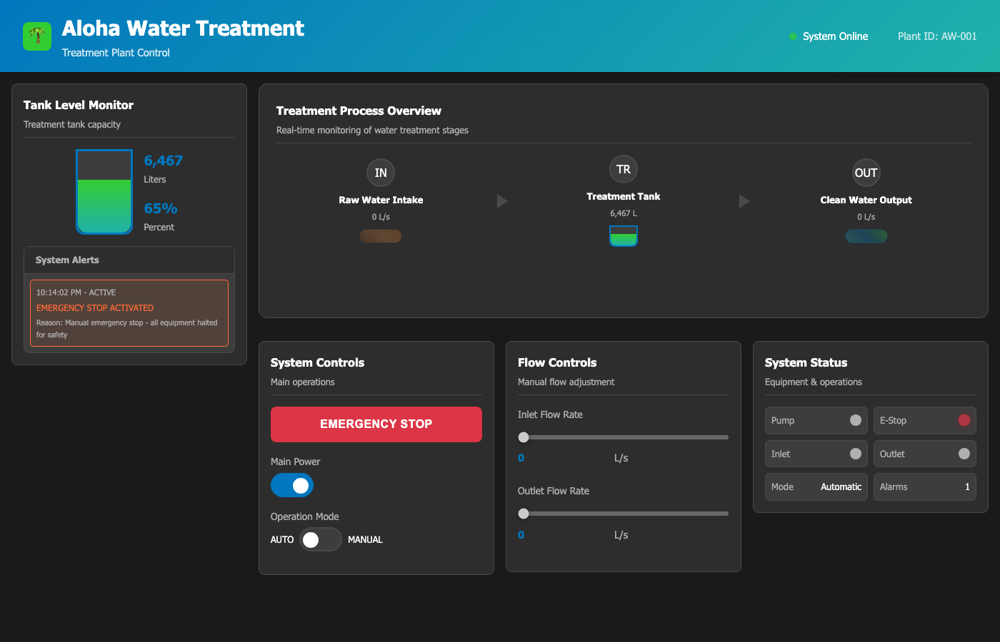

# Scenario 3: Emergency Stop

## Overview

| Field | Value |
|---|---|
| **Tactic** | Impair Process Control, Impact |
| **Techniques** | [T0855 - Unauthorized Command Message](https://attack.mitre.org/techniques/T0855/), [T0831 - Manipulation of Control](https://attack.mitre.org/techniques/T0831/), [T0826 - Loss of Availability](https://attack.mitre.org/techniques/T0826/) |
| **Adversary** | Aloha Modbus Emergency Stop (`docs/adversaries/modbus-emergency-stop.yml`), Aloha BACnet Emergency Stop (`docs/adversaries/bacnet-emergency-stop.yml`) |
| **Fact source** | Aloha Water Treatment Facts (`docs/sources/aloha-simulator-facts.yml`) |

## Description

The adversary sets the emergency stop with one unauthenticated write. The PLC obeys it on its next cycle: it stops the pump, closes both valves and sets both flow rates to zero, so the plant stops treating water. For the clearest change, run it while the pump is running, for example after scenario 2.

## Modbus Variant

### Facts Used

| Fact | Description | Type | Value |
|---|---|---|---|
| `modbus.server.ip` | IP address of the Modbus PLC | string | `127.0.0.1` |
| `modbus.server.port` | TCP port of the Modbus PLC | int | `5020` |
| `modbus.read_coil.start` | First coil to read | int | `0` |
| `modbus.read_coil.count` | Number of coils to read | int | `9` |
| `modbus.read_holding.start` | First holding register to read | int | `0` |
| `modbus.read_holding.count` | Number of holding registers to read | int | `10` |
| `modbus.write_coil.start` | Coil to write | int | `0` (EmergencyStop) |
| `modbus.write_coil.value` | Coil value to write | string | `ON` |

### Control Data

| Control | Modbus Address | Value |
|---|---|---|
| EmergencyStop | Coil `0` | `ON` |

### Steps

Run the adversary with the fact source above, or add these abilities to an operation in this order:

| # | Ability | ID | Facts |
|---|---|---|---|
| 1 | Modbus - Read Coils | `d80b9cd5-b1d8-482a-a745-71d74f9d0885` | baseline: `modbus.read_coil.start=0`, `modbus.read_coil.count=9` |
| 2 | Modbus - Write Single Coil | `056e6289-4cbf-417f-928a-d75125e4db4f` | emergency stop: `modbus.write_coil.start=0`, `modbus.write_coil.value=ON` |
| 3 | Modbus - Read Coils | `d80b9cd5-b1d8-482a-a745-71d74f9d0885` | verify: `modbus.read_coil.start=0`, `modbus.read_coil.count=9` |
| 4 | Modbus - Read Holding Registers | `bc8961a2-7534-4b2a-bbc3-2456f58243be` | verify: `modbus.read_holding.start=0`, `modbus.read_holding.count=10` |

## BACnet Variant

### Facts Used

| Fact | Description | Type | Value |
|---|---|---|---|
| `bacnet.device.instance` | Device instance of the BACnet PLC | int | `1001` |
| `bacnet.obj.type` | Object type to write | string | `binary-value` |
| `bacnet.obj.instance` | Object instance to write | int | `1` (EmergencyStop) |
| `bacnet.obj.property` | Property to write | string | `present-value` |
| `bacnet.write.priority` | Write priority | int | `8` (manual operator, the same as the HMI) |
| `bacnet.write.index` | Array index to write | int | `-1` (whole property) |
| `bacnet.write.tag` | Application tag of the value | int | `9` (enumerated) |
| `bacnet.write.value` | Value to write | int | `1` (active) |
| `bacnet.object.type` | Object type for Object Collection | string | `analog-value`, `binary-output` |
| `bacnet.object.instance` | Object instance for Object Collection | int | `1` (TankLevel, PumpStatus), `4` (OverflowAlarm) |

### Control Data

| Control | BACnet Object | Value |
|---|---|---|
| EmergencyStop | `binary-value 1 present-value` | `active` |

### Steps

Run the adversary with the fact source above, or add these abilities to an operation in this order:

| # | Ability | ID | Facts |
|---|---|---|---|
| 1 | BACnet Object Collection - Basic | `bd13ac81-b932-463d-95aa-a22aeefbc9ac` | baseline: `bacnet.object.type=binary-output`, `bacnet.object.instance=1` |
| 2 | BACnet Write Property | `1a2faf5a-4601-11eb-b378-0242ac130002` | emergency stop: `bacnet.obj.type=binary-value`, `bacnet.obj.instance=1`, `bacnet.write.tag=9`, `bacnet.write.value=1` |
| 3 | BACnet Object Collection - Basic | `bd13ac81-b932-463d-95aa-a22aeefbc9ac` | verify: `bacnet.object.type=binary-output`, `bacnet.object.instance=1` |

## Expected Observations

- The PLC accepts the write without authentication and logs it (`Client wrote ...`). The BACnet PLC logs a write only when it changes the value, so a second run while the stop is active logs nothing.
- The emergency stop turns on: Modbus coil 0 reads `ON` and holding register 1 reads `1`, and the HMI shows the emergency stop active.
- Within one second the pump stops and both valves close: coils 2-4 read `OFF` and BACnet `binary-output` 1 (PumpStatus) reads `inactive`.
- The inflow and outflow rates (holding registers 6 and 7) read `0`, and the tank level holds where it was.
- The pump switch keeps its state, but the pump does not run again until the emergency stop is cleared.
